# MiniTorch:轻量级Transformer 训练与推理框架

基于 11-868 LLM Systems Assignment扩展的轻量级深度学习框架，用于研究从 CUDA 算子、自动求导、显存管理到自回归推理调度的完整执行过程。项目提供类 PyTorch 的 Tensor / Module / Optimizer 接口，支持机器翻译模型训练，以及将 GPT-2 系列预训练权重适配到 MiniTorch 后进行推理。

主要优化包括 **fused Softmax / LayerNorm、FlashAttention、GPU 常驻张量、显存池与生命周期复用、Fused Adam、混合精度、KV Cache、PagedAttention 和 Continuous Batching**。

这是面向学习与实验的单 GPU 框架。FlashAttention 为实现的分块 CUDA 前后向传播，并非官方 FlashAttention-2/3；预训练推理的计时计算运行在 MiniTorch 中，Transformers 仅用于权重与 tokenizer 加载及非计时的正确性对照。

## 目录

- [项目结构](#项目结构)
- [支持的功能](#支持的功能)
- [安装与部署](#安装与部署)
- [训练：以 FlashAttention 为例](#训练以-flashattention-为例)
- [预训练模型推理](#预训练模型推理)
- [实验结果](#实验结果)
- [适用范围与常见问题](#适用范围与常见问题)

## 项目结构

```text
.
├── minitorch/                     # Python 框架、自动求导与 CUDA 接口
│   ├── tensor.py, autodiff.py    # 张量、广播、算子、计算图与反向传播
│   ├── module.py, modules.py     # 参数管理、基础层、Decoder-only Transformer
│   ├── kernel_config.py          # 后端 / 注意力 / 内存 / 优化器配置
│   ├── cuda_kernel_ops.py        # host 存储的传统 CUDA 包装路径
│   ├── cuda_resident_ops.py      # device 常驻张量算子
│   ├── cuda_storage.py           # CUDA 分配、传输与计数
│   ├── memory_pool.py, workspace.py # 显存池、临时工作区复用
│   ├── optim.py, packed_adam.py  # Adam 与连续参数/梯度布局的 FusedAdam
│   ├── amp.py, dtypes.py         # autocast、GradScaler、FP16/BF16 类型
│   ├── training_precision.py    # 训练精度策略
│   ├── checkpoint.py            # epoch 级保存与恢复
│   ├── pretrained_gpt2.py       # GPT-2 权重映射、GPU embedding、共享词表投影
│   ├── kv_cache.py              # 连续 KV Cache、prefill/decode 接口
│   ├── paged_kv_cache.py        # 分页 KV 池、页表与缓存生命周期
│   ├── paged_decode.py          # 不同上下文长度请求的批量 decode
│   ├── continuous_batching.py   # 请求队列、动态加入/退出、KV 预算管理
│   ├── profiling.py, inference_metrics.py # 训练/推理计时及内存指标
│   └── cuda_kernels/            # 编译生成的 .so
├── src/                         # CUDA C++ 实现
│   ├── combine.cu, cuda_runtime.cu # 基础算子、运行时与 cuBLAS 接口
│   ├── softmax_kernel.cu, layernorm_kernel.cu # 融合前后向
│   ├── flash_attention_kernel.cu, flash_attention_backward.cu # flash_attention 前后向算子
│   ├── fused_adam.cu            # 融合优化器更新
│   ├── mixed_precision.cu, amp_kernels.cu # 低精度 GEMM、转换、溢出检查
│   ├── inference_kernels.cu     # embedding、argmax、推理辅助算子
│   ├── paged_attention_kernel.cu # KV 写入、分页与批量注意力
│   └── includes/               # CUDA 公共头文件
├── project/                     # 可运行的训练和基准入口
│   ├── run_machine_translation.py # IWSLT 德英翻译训练、评估与生成
│   ├── benchmark_execution.py   # 基础算子/微型模型训练基准
│   ├── benchmark_flash_attention.py # 注意力算子比较
│   ├── benchmark_precision.py   # FP32/BF16/FP16 对照
│   ├── benchmark_inference.py   # 真实 GPT-2 模型三种推理模式比较
│   ├── benchmark_inference_synthetic.py # 随机权重推理基准
│   ├── benchmark_kv_memory.py   # KV 内存实验
│   ├── benchmark_continuous_batching.py # 串行与连续批处理比较
│   └── inference_plots.py       # 推理结果绘图
├── compile_cuda.sh             # 编译全部 CUDA 动态库
├── requirements.txt            # Python 依赖版本
└── README.md
```

运行时会生成 `output/`（基准结果、日志、checkpoint）和 `workdir_vocab_lr_embd/`（训练 tokenizer、翻译结果及评估结果）。

## 支持的功能

| 模块 | 已实现能力 |
|---|---|
| 张量与自动求导 | Tensor 运算、广播、矩阵乘、归约、反向传播、梯度累积、`no_grad` |
| Transformer | Embedding、位置编码、多头因果注意力、MLP、LayerNorm、Dropout、DecoderLM |
| 融合算子 | Softmax / LayerNorm 自定义 CUDA 融合算子，减少中间张量和逐算子调度 |
| FlashAttention | 分块 Q/K/V、在线 Softmax、反向重计算概率，避免保存完整注意力矩阵 |
| Device 执行 | 张量保留在 GPU，减少算子在 CPU/GPU 的往返；host 路径保留用于对照 |
| 内存管理 | `default`、`pooled`、`planned`；显存桶复用、反向图生命周期释放、scratch 工作区 |
| 优化器 | Adam；连续参数/梯度/动量布局与单次融合更新的 FusedAdam |
| 混合精度 | FP32 / BF16 / FP16 计算；FP32 主权重与动量、FP32 归约、动态 loss scaling、非有限梯度忽略 |
| 训练流程 | IWSLT 数据加载、BPE tokenizer、训练/验证 loss、翻译生成与 BLEU、CSV/W&B 日志、epoch checkpoint |
| 预训练适配 | 标准 GPT-2 架构的 safetensors 权重，默认 DistilGPT-2；适配器目前仅用于推理 |
| 自回归推理 | `prefill()` / `decode_step()`、位置 offset、末位置词表投影、GPU argmax、KV Cache |
| 分页缓存 | 按需分配 KV 页、页表寻址、直接分页 attention、请求结束后归还与复用 |
| Continuous Batching | 不同上下文长度的批量 decode、FIFO 准入、动态完成/取消、EOS、KV 预算约束 |

## 安装与部署

### 1. 准备 GPU 环境

训练与 CUDA 推理路径使用 **Linux 或 WSL2**。

- NVIDIA GPU、匹配的驱动、CUDA Toolkit（包含 `nvcc`、CUDA 头文件及 cuBLAS）。
- Python 3.12。
- 与 CUDA Toolkit 兼容的 C++ 编译器及 Python 开发头文件：FP16 要求 SM70+，BF16 要求 SM80+。
- 推理结果中的设备为 RTX 4060 Laptop GPU 8 GB；可运行规模取决于 batch、序列长度、模型及精度。

```bash
nvidia-smi
nvcc --version
python3.12 --version
```

### 2. 安装 Python 依赖

先克隆本仓库并进入根目录，然后执行：

```bash
python3.12 -m venv .venv
source .venv/bin/activate
python -m pip install --upgrade pip setuptools wheel
python -m pip install -r requirements.txt

export PYTHONPATH="$PWD${PYTHONPATH:+:$PYTHONPATH}"
mkdir -p output
```

### 3. 编译 CUDA kernels

```bash
bash compile_cuda.sh
```

## 训练：以 FlashAttention 为例

### 完整训练命令

下面使用 IWSLT 德英翻译数据，从头训练 Decoder-only Transformer，同时开启 GPU 常驻存储、生命周期内存复用和 FusedAdam：

```bash
python project/run_machine_translation.py \
  --dataset-name bbaaaa/iwslt14-de-en-preprocess \
  --storage-mode device \
  --attention-impl flash \
  --layernorm-impl fused \
  --memory-mode planned 
  --optimizer-impl fused_adam \
  --precision fp32 \
  --p-dropout 0 \
  --learning-rate 0.0005
```

**必须显式设置 `--p-dropout 0` 才能使用当前 FlashAttention 训练路径。** 当前 Flash kernel 不支持 attention dropout；非零 dropout 会触发兼容路径。

### 配置选项

| 参数 | 可选值 / 用途 |
|---|---|
| `--attention-impl` | `reference` / `fused_softmax` / `flash` |
| `--layernorm-impl` | `reference` / `fused` |
| `--storage-mode` | `host` / `device`；host 仍可调用 CUDA，区别在张量存储位置 |
| `--memory-mode` | `default` / `pooled` / `planned`；后两者要求 device |
| `--optimizer-impl` | `adam` / `fused_adam`；后者要求 device |
| `--precision` | `fp32` / `bf16` / `fp16`；低精度要求 device |
| `--loss-scale` | FP16 初始 loss scale，默认 65536 |
| `--warmup-steps` | 标记性能统计应排除的初始训练步，不跳过这些步的训练 |
| `--wandb-mode` | `disabled` / `offline` / `online` |
| `--resume` | 从 epoch checkpoint 恢复；其余配置须与原实验兼容 |

### 日志与恢复训练

- CSV 记录 loss、前向/反向/优化器时间、完整 step 时间、传输量、分配量与内存峰值，旁边保存 `.config.json`。
- `train/tokens_per_sec` 使用 **包含 padding 的输入 token 数 / 计算阶段耗时**；`train/end_to_end_seconds` 额外包括 batch 整理，但不包括日志和周期性评估。
- AMP 额外记录 loss scale、overflow、跳过更新次数与实际 optimizer step。
- tokenizer、生成文本和 BLEU 结果写入 `workdir_vocab_lr_embd/`。
- checkpoint 包含模型、优化器、精度/scaler 状态、RNG、tokenizer 和配置校验信息。

恢复时保留原训练命令的模型/数据/优化器/精度等参数，增加或替换：

```bash
--resume output/checkpoints_flash_fp32/epoch_0001.npz \
--n-epochs 2 --metrics-csv output/train_flash_fp32_resumed.csv
```

`--n-epochs 2` 表示总共训练到第 2 个 epoch。checkpoint 目录应位于支持 hard link 的文件系统。

## 预训练模型推理

### 单请求：full_prefix、cached、paged

```bash
python project/benchmark_inference.py \
  --model distilgpt2 \
  --modes full_prefix|cached|paged \
  --paged-prefill-impl flash \
  --new-tokens 16 \
  --warmup 1 \
  --output-dir output/distilgpt2_benchmark
```

每次自动构造 **32、128、256、512 token** 的输入；固定生成长度用于保证各模式工作量一致。每种模式在独立子进程中执行，warmup 不计入汇总。

| 模式 | 执行方式 |
|---|---|
| `full_prefix` | 每个生成步重新计算完整历史，不保留持久 KV cache |
| `cached` | 首次 prefill 后，使用连续 KV 缓存逐 token decode |
| `paged` | 首次使用连续 Q/K/V 的 Flash prefill 并写入缓存，之后直接读取分页 KV decode |

适配范围为标准 GPT-2 架构，要求 `gelu_new`、共享词嵌入及兼容的注意力配置；暂不支持直接加载 Llama/Qwen 等不同结构。

### 多请求：串行与 Continuous Batching

```bash
python project/benchmark_continuous_batching.py \
  --model distilgpt2 \
  --cache-dir output/hf_cache \
  --precision fp32 \
  --max-batch-size 4 \
  --page-size 16 \
  --kv-budget-mb 256 \
  --warmup 1 \
  --output-dir output/continuous_distilgpt2
```

默认比较同一调度器的最大 batch=1 与 batch=4，使用 6 个交错到达、输出长度不同的请求，输入覆盖四种长度。

调度器 API `ContinuousBatcher.submit()/step()/cancel()` 可用于应用侧接入。请求完成后立即归还 KV 页；同一步 decode 可以包含上下文长度不同的请求。

## 实验结果

### 训练优化

下图为项目训练实验的 W&B 导出。不同曲线运行步数不同，主要用于展示优化趋势。

| 图例 | 实验配置含义 |
|---|---|
| baseline | 标准注意力 + host 存储 |
| fused and host | fused Softmax + host 存储 |
| fused and device | fused Softmax + GPU 常驻存储 |
| flash and device | FlashAttention + GPU 常驻存储 |
| flash planned | 进一步使用显存池与生命周期复用 |
| flash planned fused-adam | 进一步使用融合优化器 |
| flash bf16 / flash fp16 | 低精度训练实验；其余与如上配置相同 |

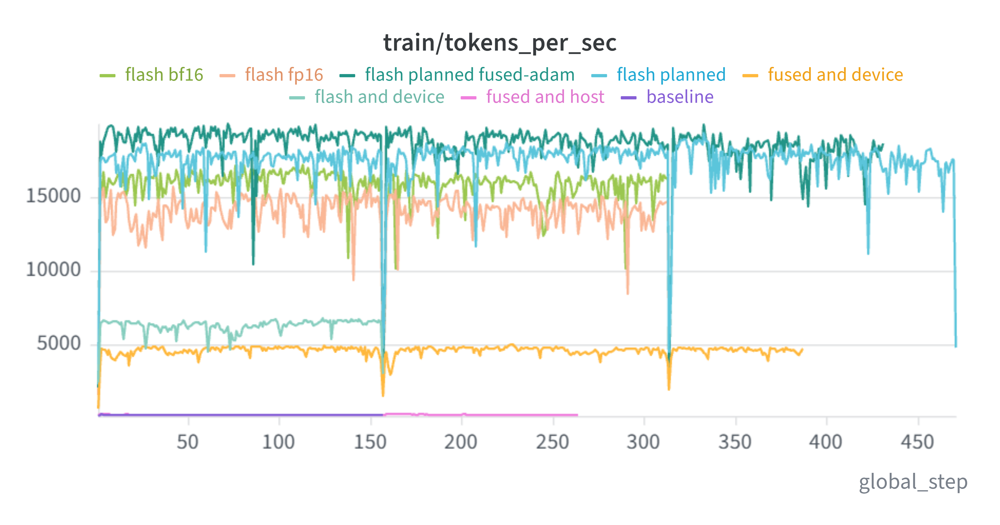

**吞吐量：**host 到 device 的变化带来明显提升，说明减少传输与运行时开销是重要优化来源。在 device 后端上，FlashAttention、planned 内存复用和 FusedAdam 进一步提高吞吐量。图中的 BF16/FP16 并未超过优化后的 FP32，不能将混合精度等同于必然加速。

<table>
<tr><td>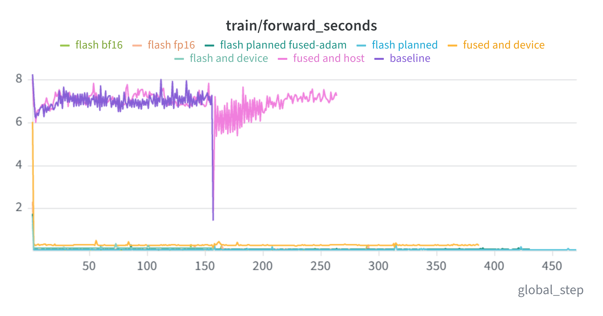</td><td>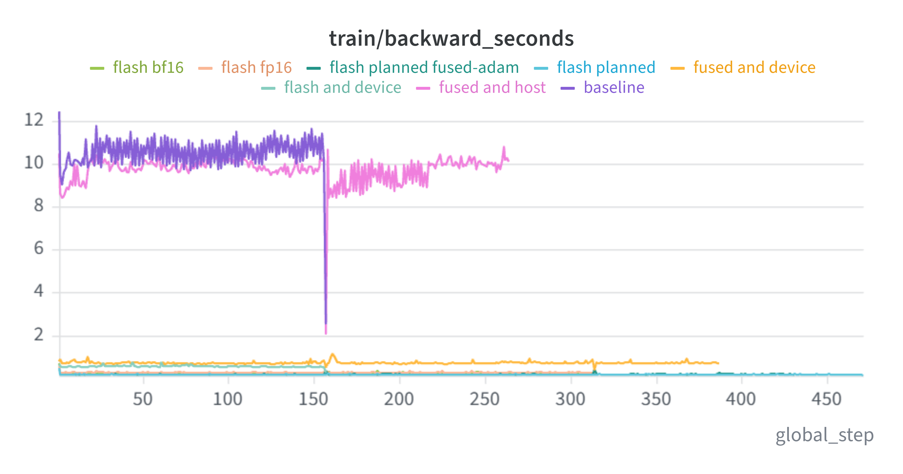</td></tr>
<tr><td>前向计算时间</td><td>反向传播时间</td></tr>
<tr><td>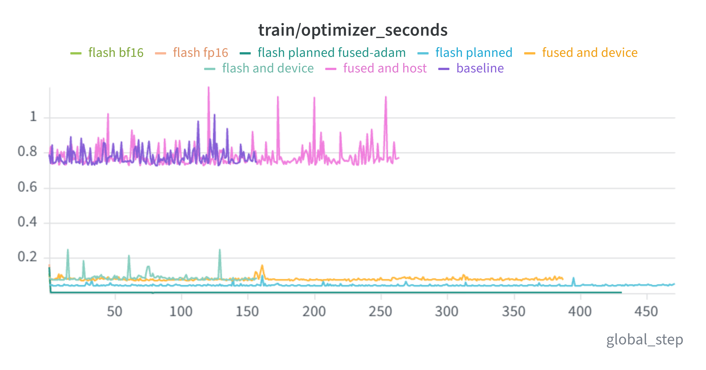</td><td>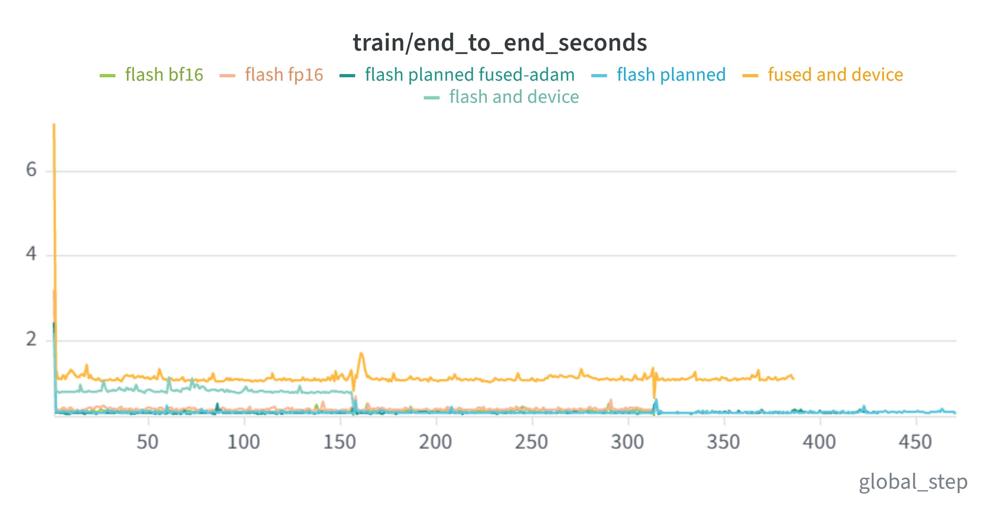</td></tr>
<tr><td>优化器更新耗时</td><td>包含 batch 整理的 step 耗时</td></tr>
</table>
**分阶段时间：**融合算子、设备常驻存储和内存复用共同降低前后向开销；FusedAdam 的优势主要体现在更新阶段。最终收益应以完整 step 时间和相同工作量的吞吐量衡量。

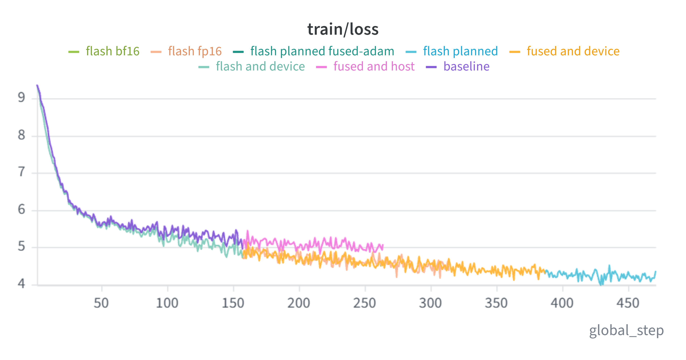

**收敛：**各路径 loss 总体下降，未从图中观察到明显发散；这不能替代数值误差检查、相同成功更新次数下的验证 loss 和 BLEU 比较。

<details>
<summary>查看 GPU 利用率与内存曲线</summary>

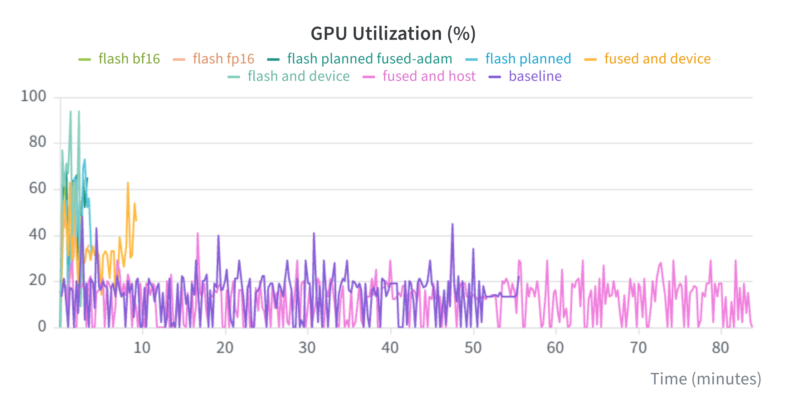
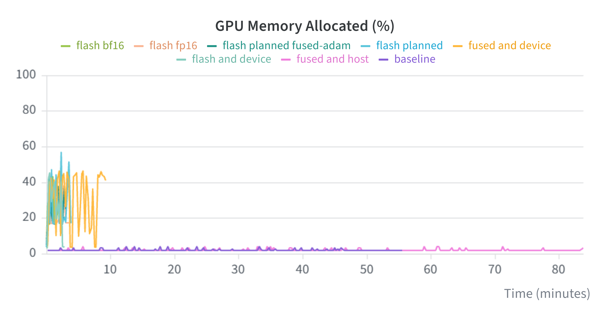
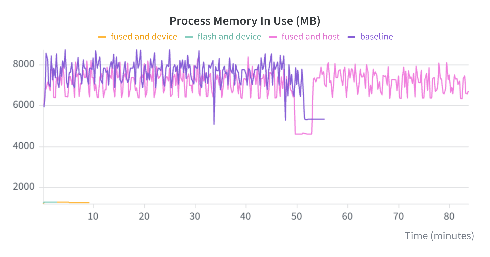

 device 路径提高 GPU 活跃程度，并把部分存储需求从主机移到设备。Process Memory In Use 表示主机进程内存，不能作为显存下降的证据；GPU 显存占用也不等于 KV 有效载荷。显存池可能保留空闲块，应区分 active、reserved、KV live/capacity 与整个进程显存。

</details>

### 单请求推理

DistilGPT-2，RTX 4060 Laptop GPU，FP32，batch=1，每次生成 16 tokens；每组预热 1 次、测量 3 次，所有模式输出 token 一致。

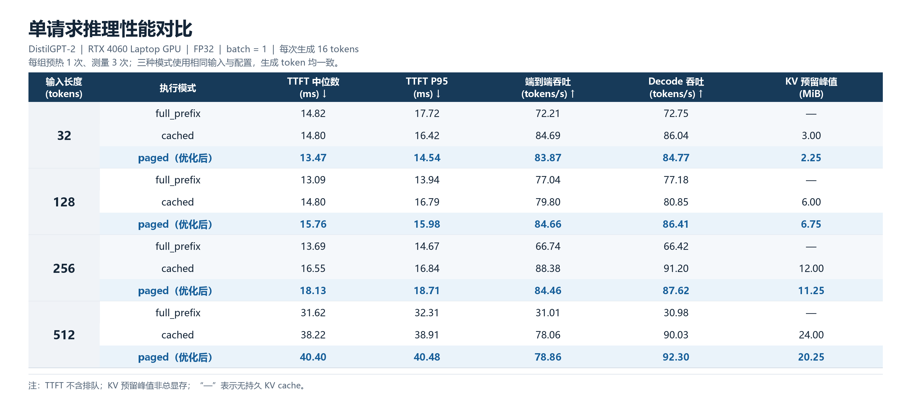

- 输入 512 tokens 时，`full_prefix`、`cached`、`paged` 的端到端吞吐分别为 **31.01 / 78.06 / 78.86 tokens/s**，paged 约为 full_prefix 的 **2.54×**。
- 同长度下，paged 的 KV 预留峰值为 **20.25 MiB**，cached 为 **24.00 MiB**，减少 **15.6%**。
- paged 不保证单请求全面优于连续缓存。例如 256-token 输入下 cached 吞吐更高，128-token 输入下 paged 预留空间更大。分页分配粒度和间接寻址都有成本。
- KV Cache 主要优化 decode；首次分配和 prefill 仍需执行，因此 512-token 的 cached/paged TTFT 高于 full_prefix 是本次实验的实际结果。

### Continuous Batching

同一设备和模型，FP32；每轮 6 个交错到达请求，共生成 60 tokens，预热 1 轮、测量 3 轮。串行与连续批处理各完成 18 个请求。

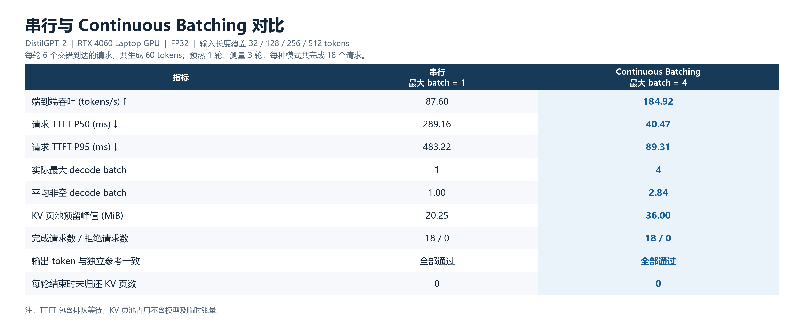

- 总吞吐从 **87.60 → 184.92 tokens/s**，约 **2.11×（+111.1%）**。
- 含排队的请求 TTFT P50 从 **289.16 → 40.47 ms**，下降约 **86.0%**；P95 从 **483.22 → 89.31 ms**，下降约 **81.5%**。
- 实际最大 decode batch 为 4，平均非空 batch 为 2.84；每轮结束后未归还 KV 页均为 0。
- 多个并发请求需要更多活跃 KV，页池预留峰值从 **20.25 → 36.00 MiB**。分页不保证并发时绝对峰值更低。

## 适用范围与常见问题

- **FlashAttention 边界：**当前为标量分块 CUDA 实现，head dimension ≤128，不支持 attention dropout、GQA/MQA 或任意稠密 additive mask；没有实现官方 FlashAttention 的 Tensor Core MMA / FA2 调度。
- **调度边界：**单 GPU、默认 CUDA stream、单线程驱动；尚无 chunked prefill、prefix sharing、抢占/换出、beam search、多 GPU 或 HTTP 服务。长 prefill 可能影响活跃请求的 token 间隔。
- **GPU 内存不足：**降低 batch、序列长度或 KV budget；`--kv-budget-mb` 限制 KV slab 有效载荷，不包含权重、元数据与临时张量。

项目源自课程框架并在其上扩展。此部署检查使用上述可运行 benchmark，不应把历史测试数量当作当前 checkout 刚刚执行的结果。
